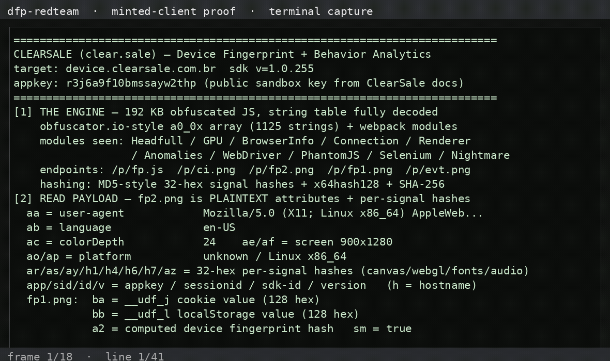

# dfp-redteam-clearsale — ClearSale Device Fingerprint SDK

Authorized red-team on ClearSale's public **sandbox** fingerprint service
(`device.clearsale.com.br`, public appkey `r3j6a9f10bmssayw2thp` from
ClearSale's own docs). No customer/prod traffic. Full detail:
[`CLEARSALE_BREAK_2026_11_02.md`](CLEARSALE_BREAK_2026_11_02.md).

---

## What we proved

ClearSale ships a **192 KB obfuscated** fingerprint engine (`fp.js`,
`@clear.sale/behavior-analytics-fingerprint-sdk` v1.0.255) that POSTs device
data as **plaintext 1×1 image GETs**:

- `fp2.png` — **plaintext attributes**: `aa`=UA, `ab`=language, `ac`=colorDepth,
  `ae/af`=screen, `ao/ap`=platform, plus `ar/as/ay/h1/h4/h6/h7/az` =
  **32-hex per-signal hashes** (canvas / WebGL / fonts / audio)
- `fp1.png` — identity: `ba` = `__udf_j` **cookie** value (128 hex),
  `bb` = `__udf_l` **localStorage** value (128 hex), `a2` = computed device
  fingerprint hash, `sm` flag
- `ci.png` — cookie-capability pixel (no server-side Set-Cookie — confirmed)
- `evt.png` — behavior events; `e.png?m=` — error beacon

**The device identity is client-generated and client-persisted.** `ba`/`bb`
are GUIDs the engine mints on first run and stores in cookie + localStorage;
the server never issues them. That makes identity **fully mintable** — we
pre-seeded `__udf_j=ff…ff` and `__udf_l=aa…aa`, and fp1.png shipped them
**verbatim** with server **200**. No format/identity validation observed
(contrast Kount, which 400-rejects a garbage FPCV).

## Status

- 🟢 Read payload: engine string table fully decoded (1125 strings);
  fp2.png attributes plaintext; ba/bb identity readable end-to-end
- 🟢 Tamper with payload: fp2/fp1 params rewritten mid-flight
  (UA/language/screen/`sm`) → **accepted (200)**
- 🟢 Mint token: **device ID entirely client-forgeable** (`__udf_j` cookie +
  `__udf_l` localStorage) — shipped verbatim, accepted (200);
  `sessionid` is client-chosen by design
- The moat is server-side (ClearSale Total scoring + behavior graph on the
  client-asserted identity) — scoring layer not assessed (no merchant creds)

## Recorded demo

<video src="assets/demo-clearsale.mp4" width="720" controls></video>

## Artifacts (hyperlinked)

- [`artifacts/fp.js.sdk-1.0.255.obfuscated`](artifacts/fp.js.sdk-1.0.255.obfuscated) — the shipped 192 KB engine
- [`artifacts/fp-decoded.js`](artifacts/fp-decoded.js) — same engine with the string table resolved
- [`artifacts/string-table-decoded.txt`](artifacts/string-table-decoded.txt) — all 1125 decoded strings
- [`artifacts/capture-requests.json`](artifacts/capture-requests.json) — full flow (ci.png → fp2.png → fp1.png)
- [`artifacts/tamper-result.json`](artifacts/tamper-result.json) — rewritten params + 200s
- [`artifacts/mint-result.json`](artifacts/mint-result.json) — forged ba/bb shipped verbatim + 200

## Scripts (`scripts/`)

- `csl-capture.mjs` — drive the real engine; capture the full beacon flow
- `csl-deobfuscate.mjs` — extract + decode the string table (shuffle-checksum exact)
- `csl-tamper.mjs` — rewrite fp2/fp1 mid-flight (tamper) or pre-seed forged
  identity (mint)
- `demo-csl.py` — print the full analysis (used for the recorded demo)

## Honest caveats

- Assessed against the **public sandbox appkey**; no customer/prod collection.
- `a2` and the 32-hex signal hashes are opaque (we mapped their source
  functions in the engine but didn't invert the MD5 hashes).
- Server-side scoring/decisioning was not assessed (ClearSale Total requires
  merchant credentials).
